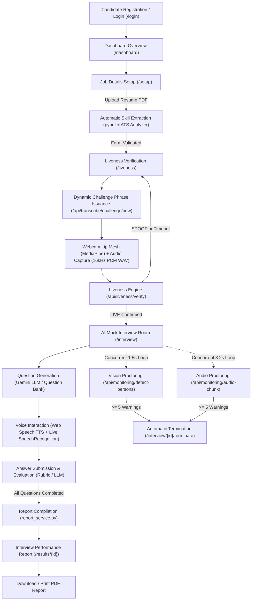

# LIVESCAN 2.0 – Complete Technical Documentation & Viva/Placement Guide

---

## 1. Project Overview

### 1.1 Objectives & Vision
**LIVESCAN 2.0** is an enterprise-grade, multimodal AI-powered interview platform and biometric identity verification system. Its mission is to solve the critical vulnerabilities of modern remote hiring:
1. **Interview Impersonation & Proxy Candidates:** Preventing unauthorized third parties, deepfakes, pre-recorded videos, and photo replay attacks from taking interviews on behalf of the applicant.
2. **Real-Time Proctoring & Exam Integrity:** Detecting multiple faces, unauthorized assistants, looking-away behaviors, and background voices during live technical evaluations.
3. **Objective Technical Assessment:** Providing standardized, rubric-driven, and generative AI evaluations of spoken and typed responses without arbitrary minimum score floors or grade inflation.

### 1.2 Core Problem Statement
Traditional remote technical interviews suffer from:
* **Presentation Attacks (PAD):** Simple photo replay, cut-out masks, screen-replay attacks, and synthetic lip-syncing (e.g., Wav2Lip, DeepFaceLab).
* **Subject-Independent Liveness Failure:** Fixed heuristic thresholds fail on diverse ethnicities, lighting conditions, and camera framerates.
* **Scoring Hallucinations:** AI evaluators that award 5/10 marks even when candidates say *"I don't know"* or remain silent.
* **Proctoring False Positives:** Cascade detectors that misclassify shadows or eye-corners as "two faces detected" on a single seated candidate, or flag the candidate's own voice as "background intruder speech."

### 1.3 Key Features
* **Multimodal Liveness Authentication:** Correlates real-time 3D facial mesh lip movements with microphone voice energy (RMS) via cross-correlation with lag estimation over a permissible temporal window ($\le 500\text{ ms}$).
* **Dynamic Multilingual Challenge-Response:** Generates unscripted challenge phrases in **English**, **Hindi**, and **Marathi** with Unicode NFC normalization, Devanagari phonetic canonicalization, and Faster-Whisper ASR transcription.
* **Job Details & Resume ATS Skill Extraction:** Automatically parses PDF/DOCX resumes using `pypdf`, extracts technical skills without manual entry, and validates form completeness before granting interview access.
* **Dual-Engine Interview Generation & Evaluation:** Generates role-tailored questions using **Google Gemini** (`gemini-2.0-flash` / `gemini-1.5-flash`) or an intelligent fallback to a **Curated Role-Based Question Bank** covering 9 core IT roles and 5 experience tiers.
* **Proctoring & Anti-Cheat Suite:** Real-time multi-face detection with candidate-affinity tracking (guaranteeing the seated candidate remains Face 1 in green, and an intruder is labeled Face 2 in red), gaze tracking, blink-immunity debouncing, and dual-speaker audio analysis.
* **Standardized Performance Reporting:** Comprehensive report cards, Recharts radar charts, question-by-question transcripts, coaching advice, and print-to-PDF formatting.

---

## 2. Complete End-to-End Workflow Architecture



---

## 3. Liveness Verification Module (Deep Dive)

### 3.1 MediaPipe FaceMesh & 3D Lip Landmark Tracking
* **Library:** `@mediapipe/face_mesh` (`FaceMesh`) running client-side at ~30 FPS on the HTML5 `<video>` feed.
* **Key Landmarks Tracked:**
  * Landmark `13`: Upper Inner Lip Center $(x_{13}, y_{13}, z_{13})$
  * Landmark `14`: Lower Inner Lip Center $(x_{14}, y_{14}, z_{14})$
  * Landmark `61`: Left Lip Corner $(x_{61}, y_{61})$
  * Landmark `291`: Right Lip Corner $(x_{291}, y_{291})$
* **Scale & Distance-Invariant Vertical Aperture Formula:**
  $$\text{Vertical Distance} = \sqrt{(x_{13} - x_{14})^2 + (y_{13} - y_{14})^2}$$
  $$\text{Horizontal Lip Width} = \sqrt{(x_{61} - x_{291})^2 + (y_{61} - y_{291})^2}$$
  $$\text{Lip Aperture Ratio } A(t) = \frac{\text{Vertical Distance}}{\text{Horizontal Lip Width}}$$
  *Why normalize by lip width?* If a candidate moves closer to or farther from the camera, raw pixel distance changes drastically. Dividing by horizontal lip width makes the aperture scale-invariant.

### 3.2 Lip Movement Variance & Static Photo Defense
* **Service:** [lip_service.py](file:///d:/6th%20sem/lip-voice-liveness/ai-mock-interviewer/backend/services/lip_service.py)
* **Metric:** Sample Variance $\sigma^2$ across the temporal series of apertures $A(t_1), A(t_2), \dots, A(t_n)$:
  $$\sigma^2 = \frac{1}{N - 1} \sum_{i=1}^{N} (A(t_i) - \mu)^2$$
* **Threshold:** `MIN_LIP_VARIATION = 0.0002`
* **Security Rule:** If $\sigma^2 < 0.0002$, the system classifies the attempt as **SPOOF: Static image / No genuine lip movement detected**. This prevents attackers from holding a printed photograph or displaying a frozen image while speaking off-camera.

### 3.3 Audio Processing & RMS Energy Envelope
* **Service:** [sync_service.py](file:///d:/6th%20sem/lip-voice-liveness/ai-mock-interviewer/backend/services/sync_service.py)
* **Audio Format Conversion:** Browser records WebM (Opus audio codec) via `MediaRecorder`. The backend converts this to standard $16\text{ kHz}$ mono 16-bit PCM WAV using an automated FFmpeg pipeline (`convert_to_wav`).
* **Root-Mean-Square (RMS) Envelope Calculation:**
  For each visual frame timestamp $t_i$, an audio window of duration $\Delta t = \max(30\text{ ms}, t_i - t_{i-1})$ centered at $t_i$ is sampled:
  $$\text{RMS}(t_i) = \sqrt{\frac{1}{M} \sum_{k=1}^{M} s[k]^2}$$
  where $s[k]$ are audio samples within the time window.
* **Energy Threshold:** `MIN_AUDIO_ENERGY = 0.02`. If overall RMS energy is below this, the audio is flagged as silence.

### 3.4 Cross-Correlation with Lag Search
* **Signal Conditioning:**
  1. Both Lip Aperture $A(t)$ and Audio RMS $E(t)$ are smoothed with a 5-frame centered moving average filter (`smooth_signal`).
  2. Both signals are Min-Max normalized to the interval $[0, 1]$ (`normalize_signal`).
* **Pearson Cross-Correlation Function:**
  $$r(x, y) = \frac{\sum_{i=1}^{n} (x_i - \bar{x})(y_i - \bar{y})}{\sqrt{\sum_{i=1}^{n} (x_i - \bar{x})^2} \sqrt{\sum_{i=1}^{n} (y_i - \bar{y})^2}}$$
* **Lag Optimization Search:**
  Because browser video buffers and microphone capture may experience a physical hardware or transmission delay, the system searches for optimal correlation across a bounded time window:
  $$\tau \in [-\text{search\_lag}, +\text{search\_lag}]$$
  where $\text{SYNC\_MAX\_LAG\_MS} = 500\text{ ms}$.
* **Evaluation Criteria:**
  - Evaluates raw correlation at lag 0, speech-segmented correlation (where audio energy exceeds threshold), and velocity correlation ($\Delta A(t)$ vs $\Delta E(t)$).
  - **Rejection Rule:** If optimal lag $|\tau| > 500\text{ ms}$, or best correlation $r_{\text{best}} < \text{LIVE\_SYNC\_THRESHOLD} (0.45)$, the verification fails with **SPOOF: Audio-video desynchronization**.

### 3.5 Challenge Phrase Verification (Faster-Whisper)
* **Services:** [whisper_service.py](file:///d:/6th%20sem/lip-voice-liveness/ai-mock-interviewer/backend/services/whisper_service.py) and [verification_service.py](file:///d:/6th%20sem/lip-voice-liveness/ai-mock-interviewer/backend/services/verification_service.py)
* **ASR Model:** Faster-Whisper `tiny` (CPU-optimized CTranslate2 execution).
* **Phonetic & Text Normalization:**
  - Devanagari chandrabindu (`ँ`, U+0901) converted to anusvara (`ं`, U+0902) so variations like *पाँच* and *पांच* match.
  - Devanagari nukta stripped so *पेड़* and *पेड* match.
  - Numbers normalized: Devanagari digits (`०`..`९`) $\to$ ASCII digits $\to$ canonical language words (*7* $\to$ *seven* in English, *सात* in Hindi).
* **Composite Speech Verification Formula:**
  $$\text{Speech Match Score} = 0.40 \times \text{CharacterSimilarity} + 0.40 \times \text{WordSimilarity} + 0.20 \times \text{WhisperConfidence}$$
* **Threshold:** Must achieve $\ge 70.0\%$ to pass. If the candidate remains silent or speaks an incorrect phrase, `is_phrase_pass = False`, resulting in **SPOOF: Challenge phrase mismatch**.

---

## 4. AI Interview Module & Scoring Engine

### 4.1 Question Generation Sources
Questions originate from two synchronized tiers in [interview_engine.py](file:///d:/6th%20sem/lip-voice-liveness/ai-mock-interviewer/backend/services/interview_engine.py):

#### Tier 1: Google Gemini LLM (Generative)
* When `GEMINI_API_KEY` is present, prompts are dispatched to `gemini-2.0-flash` or `gemini-1.5-flash` via the official `google-genai` SDK.
* Context parameters injected into prompt: Target Role, Experience Level, Interview Focus Area, Candidate Skills extracted from resume, and Job Description / About Yourself.
* **Repetition Guard:** An `avoid_list` containing up to 12 previously asked session and historical user questions is sent with strict negative prompt instructions (*"DO NOT repeat or paraphrase any of these questions"*).

#### Tier 2: Curated Role-Based Question Bank (Deterministic Fallback)
* Defined in [question_bank.py](file:///d:/6th%20sem/lip-voice-liveness/ai-mock-interviewer/backend/services/question_bank.py).
* Supports **9 Canonical Roles:**
  1. `python_developer`
  2. `java_developer`
  3. `full_stack_developer`
  4. `react_developer`
  5. `backend_developer`
  6. `frontend_developer`
  7. `software_engineer`
  8. `data_analyst`
  9. `hr_interview`
* Each question contains:
  - `question`: Precise prompt text.
  - `expected`: Technical keywords required in a complete response.
  - `expected_guidelines`: Detailed scoring rubric.
  - `difficulty`: Easy, Medium, Hard.

### 4.2 Answer Evaluation & Anti-Default Scoring
Implemented in `evaluate_answer` in [interview_engine.py](file:///d:/6th%20sem/lip-voice-liveness/ai-mock-interviewer/backend/services/interview_engine.py):

#### Rule 1: Inability / Non-Answer Filter (Strict 0.0 / 10)
Identified via `is_inability_or_refusal(clean_answer)`. Matches regex patterns such as:
- *"i don't know"*, *"i do not know"*, *"no idea"*, *"cannot answer"*, *"sorry, i am unable to answer"*, *"skip"*, *"pass"*.
- Empty or whitespace strings.
- **Result:** Strict $0.0 / 10$ across Technical Accuracy, Communication, Relevance, and Completeness. No default marks.

#### Rule 2: Off-Topic Filter
- Compares candidate answer tokens against expected question concepts and question keywords.
- If $0$ expected concepts match AND $0$ question keywords match:
  - Short answers ($< 15$ words): **0.0 / 10**.
  - Long irrelevant filler: maximum **0.5 / 10**.

#### Rule 3: Substantive Technical Scoring
- Scored across 4 pillars: Technical Accuracy, Communication, Relevance, and Completeness.
- Evaluation mode flags: `LLM (Google Gemini)` when API is active, or `Curated Evaluation Rubric` when running offline.

---

## 5. Interview Proctoring & Monitoring Suite

### 5.1 Real-Time Face & Multi-Person Detection
* **Dual Execution:**
  1. **Client-side (MediaPipe FaceMesh):** Detects up to 2 faces at 30 FPS.
  2. **Backend (OpenCV Haar Cascades):** POST `/api/monitoring/detect-persons` every $1.5\text{ s}$ using frontal, alt2, and profile cascades.

#### Multi-Box Deduplication Algorithm
To prevent glasses, shadows, or beards from registering as "two faces detected", [person_detection_service.py](file:///d:/6th%20sem/lip-voice-liveness/ai-mock-interviewer/backend/services/person_detection_service.py) enforces:
- $\text{IoU} \ge 0.30$
- Containment $\text{IoMin} = \frac{\text{Inter}}{\min(\text{Area}_1, \text{Area}_2)} \ge 0.55$
- Center proximity: $\text{distance} < 1.15 \times \min(w, h)$ or $(\Delta x < 0.95w \land \Delta y < 1.15h)$.
Boxes meeting these conditions are consolidated into one physical individual.

#### Candidate Affinity Prioritization (Face 1 vs Face 2)
To guarantee the seated candidate is always **Face 1** and any intruder entering from the edge is **Face 2**:
$$\text{Priority Score} = \text{AreaBonus} + 2.5 \times \text{AnchorAffinity} - 3.5 \times \text{CenterDistancePenalty}$$
- The seated candidate receives a score $> 3.0$ and is rendered with a **Green Bounding Box (`#10B981`)** labeled *"Face 1 (Candidate)"*.
- The intruder receives a penalty $< 0.0$ and is rendered with a **Red Bounding Box (`#EF4444`)** labeled *"Face 2 (Extra Person)"*.

### 5.2 Eye-Gaze & Look-Away Detection
- Analyzes eyes inside the upper 65% of the primary face bounding box using `haarcascade_eye_tree_eyeglasses.xml`.
- If horizontal face center ratio $< 0.20$ or $> 0.80$, or profile cascade triggers with $< 2$ eyes visible, flags `LOOKING_AWAY`.
- 1-frame blink immunity: single-frame dips are ignored; 2+ consecutive frames show a yellow warning banner *"Please face the camera"*.

### 5.3 Background Speech & Multi-Voice Detection
* **Service:** [audio_monitoring_service.py](file:///d:/6th%20sem/lip-voice-liveness/ai-mock-interviewer/backend/services/audio_monitoring_service.py)
* Transcribes 2.2-second WebM audio chunks via Faster-Whisper.
* Calculates dual-speaker presence and energy levels.
* **Integrity Rule:** `is_suspicious_speech = is_speech and dual_speakers`. If only the candidate speaks aloud, no warning is generated.

### 5.4 Automatic Termination Policy
* Debouncer requires $3$ consecutive confirmation frames (`MONITORING_PERSON_CONFIRMATION_FRAMES = 3`).
* Exactly $1$ warning is logged per continuous infraction until cleared for $2.0\text{ s}$.
* If cumulative warnings reach **5** (`MAX_MONITORING_WARNINGS = 5`), the session auto-terminates with status `terminated` and redirects to `/results/{id}`.

---

## 6. Voice Interaction Engine

| Functionality | Technology / API | Exact File Location | Purpose |
|---|---|---|---|
| **Text-to-Speech (TTS)** | Web Speech API (`window.speechSynthesis`) | [VoiceInterview.jsx](file:///d:/6th%20sem/lip-voice-liveness/ai-mock-interviewer/frontend/src/components/VoiceInterview.jsx) | Speaks interview questions aloud in browser with auto-speak controls. |
| **Real-Time Live STT** | Web Speech API (`SpeechRecognition`) | [Interview.jsx](file:///d:/6th%20sem/lip-voice-liveness/ai-mock-interviewer/frontend/src/pages/Interview.jsx) | Transcribes candidate's spoken answers into the text box in real time. |
| **High-Precision ASR** | Faster-Whisper (`Systran/faster-whisper-tiny`) | [whisper_service.py](file:///d:/6th%20sem/lip-voice-liveness/ai-mock-interviewer/backend/services/whisper_service.py) | Server-side Whisper transcription of recorded challenge audio for liveness check. |
| **Audio Monitoring ASR** | Faster-Whisper CTranslate2 | [audio_monitoring_service.py](file:///d:/6th%20sem/lip-voice-liveness/ai-mock-interviewer/backend/services/audio_monitoring_service.py) | Transcribes periodic 2.2s background audio slices to detect extra voices. |

---

## 7. Technology Stack Reference Table

| Category | Technology | Version | Purpose in LIVESCAN 2.0 |
|---|---|---|---|
| **Frontend Framework** | React.js | 19.x / 18.x | Client SPA architecture, hooks, real-time video/canvas rendering. |
| **Build Tool** | Vite | 8.x | Fast HMR, production bundling, optimized asset delivery. |
| **Styling** | Tailwind CSS | 4.x | Dark-mode interface, responsive grid, alert badges, print stylesheets. |
| **Biometric Vision** | MediaPipe FaceMesh | 0.4.x | 468-point 3D facial mesh, tracking lip landmarks 13, 14, 61, 291. |
| **Data Visualization** | Recharts | 2.x | Skill breakdown radar charts and interview score trend line charts. |
| **Backend Framework** | FastAPI | 0.115+ | High-performance asynchronous Python REST API server. |
| **ASGI Server** | Uvicorn | 0.34+ | ASGI web server hosting FastAPI endpoints. |
| **Computer Vision** | OpenCV (`cv2`) | 4.11+ | Multi-cascade face detection, CLAHE lighting enhancement, image decoding. |
| **Audio Processing** | PySoundFile & NumPy | 0.13+ / 2.2+ | 16kHz PCM audio conversion, RMS energy envelopes, cross-correlation. |
| **Media Conversion** | FFmpeg (Gyan Essentials) | 7.x | WebM/Opus to 16kHz WAV audio format conversion pipeline. |
| **Speech Recognition** | Faster-Whisper | 1.1+ | CTranslate2-based Whisper execution for CPU transcription. |
| **Generative AI** | Google GenAI SDK | 1.x (`google-genai`) | Gemini 2.0/1.5 Flash for dynamic questions, ATS feedback, coaching summaries. |
| **PDF Extraction** | PyPDF | 5.3+ | Text and section extraction from candidate PDF resumes. |
| **Database** | MongoDB & PyMongo | 7.x / 4.11+ | NoSQL document storage for users, interviews, resumes, monitoring logs. |
| **Authentication** | PyJWT & Passlib (Bcrypt) | 2.10+ / 1.7+ | Password hashing, JWT token issuance, Bearer token validation. |

---

## 8. Database Architecture & Schemas

Database Name: `ai_mock_interview` (and `liveness_db` for standalone biometric trials) on `mongodb://localhost:27017`.

### 8.1 Collection: `users`
Stores registered candidate accounts.
```json
{
  "_id": "ObjectId('6b0144fd2d2f6eee0d2dcd4a')",
  "name": "Jane Doe",
  "email": "jane@example.com",
  "password_hash": "$2b$12$K8...",
  "created_at": "ISODate('2026-11-21T12:00:00Z')"
}
```

### 8.2 Collection: `interviews`
Stores complete interview session history, transcripts, evaluations, and proctoring audits.
```json
{
  "_id": "ObjectId('6b0145002d2f6eee0d2dcd58')",
  "user_id": "6b0144fd2d2f6eee0d2dcd4a",
  "candidate_email": "jane@example.com",
  "role": "Python Developer",
  "interview_type": "Comprehensive Interview",
  "difficulty": "Fresher",
  "status": "completed",
  "termination_reason": null,
  "warning_count": 0,
  "max_warnings": 5,
  "monitoring_warnings": [],
  "monitoring_session_id": "mon_session_918237",
  "question_count": 3,
  "answers": [
    {
      "question": "What is the difference between a list and a tuple in Python?",
      "answer": "Lists are mutable while tuples are immutable and hashable.",
      "score": 9.0,
      "status": "answered",
      "evaluation": {
        "score": 9.0,
        "technical_score": 9.5,
        "communication_score": 8.5,
        "relevance_score": 9.0,
        "completeness_score": 9.0,
        "feedback": "Clear explanation of mutability and dictionary key usage.",
        "strengths": ["Accurate mutability distinction", "Correct terminology"],
        "improvements": ["Mention memory allocation overhead"]
      }
    }
  ],
  "report": {
    "overall_score": 8.5,
    "technical_score": 9.0,
    "communication_score": 8.0,
    "relevance_score": 8.5,
    "performance_level": "Excellent",
    "summary": "Candidate demonstrated strong command of Python Developer concepts during the Comprehensive Interview session.",
    "top_strengths": ["Accurate mutability distinction", "Clear communication"],
    "areas_to_improve": ["Review memory optimization techniques"],
    "recommended_topics": ["Python Developer Core Principles", "Comprehensive Interview Best Practices"]
  },
  "created_at": "ISODate('2026-11-21T12:05:00Z')",
  "completed_at": "ISODate('2026-11-21T12:15:00Z')"
}
```

### 8.3 Collection: `resumes`
Stores candidate ATS resume extraction documents.
```json
{
  "_id": "ObjectId('6b0145222d2f6eee0d2dcd99')",
  "user_id": "6b0144fd2d2f6eee0d2dcd4a",
  "filename": "Jane_Doe_Resume.pdf",
  "file_path": "uploads/resumes/2548605a-b626-4155-9ca9-424168498836.pdf",
  "resume_text": "Jane Doe... Skills: Python, React, FastAPI, Docker, SQL...",
  "analysis": {
    "ats_score": 88,
    "technical_skills": ["Python", "React", "FastAPI", "Docker", "SQL"],
    "soft_skills": ["Communication", "Problem Solving"],
    "score_breakdown": {
      "contact_details": 20,
      "section_coverage": 38,
      "skills_and_keywords": 25,
      "formatting_and_readability": 15
    }
  },
  "created_at": "ISODate('2026-11-21T12:02:00Z')"
}
```

### 8.4 Collection: `monitoring_events`
Audit trail of real-time proctoring occurrences.
```json
{
  "_id": "ObjectId('6b0145452d2f6eee0d2dcdaa')",
  "sessionId": "mon_session_918237",
  "eventType": "ADDITIONAL_PERSON_DETECTED",
  "severity": "WARNING",
  "details": "Multiple faces detected (2). Please ensure only you are visible.",
  "metadata": { "detectedCount": 2, "faceCount": 2 },
  "timestamp": "2026-11-21T12:10:30.125Z"
}
```

---

## 9. Feature Implementation Status Matrix

| Module | Sub-Feature | Implementation Status | Implementation File Reference |
|---|---|---|---|
| **Liveness Verification** | 3D Lip Landmark Tracking | **Implemented (Production)** | [LivenessVerificationPage.jsx](file:///d:/6th%20sem/lip-voice-liveness/ai-mock-interviewer/frontend/src/pages/LivenessVerificationPage.jsx) (MediaPipe 13, 14, 61, 291) |
| **Liveness Verification** | Scale-Invariant Aperture | **Implemented (Production)** | [lip_service.py](file:///d:/6th%20sem/lip-voice-liveness/ai-mock-interviewer/backend/services/lip_service.py) |
| **Liveness Verification** | Cross-Correlation & Lag ($\le 500\text{ms}$) | **Implemented (Production)** | [sync_service.py](file:///d:/6th%20sem/lip-voice-liveness/ai-mock-interviewer/backend/services/sync_service.py) (`cross_correlation_with_lag`) |
| **Liveness Verification** | Multilingual Challenge Phrases | **Implemented (Production)** | [verification_service.py](file:///d:/6th%20sem/lip-voice-liveness/ai-mock-interviewer/backend/services/verification_service.py) (English, Hindi, Marathi) |
| **Liveness Verification** | Static Photo Defense | **Implemented (Production)** | [sync_service.py](file:///d:/6th%20sem/lip-voice-liveness/ai-mock-interviewer/backend/services/sync_service.py) (`variance < 0.0002` SPOOF check) |
| **Job Setup** | 7-Field Ordered Layout | **Implemented (Production)** | [InterviewSetup.jsx](file:///d:/6th%20sem/lip-voice-liveness/ai-mock-interviewer/frontend/src/pages/InterviewSetup.jsx) |
| **Job Setup** | Auto Resume Skill Extraction | **Implemented (Production)** | [InterviewSetup.jsx](file:///d:/6th%20sem/lip-voice-liveness/ai-mock-interviewer/frontend/src/pages/InterviewSetup.jsx) via `/resume/analyze` |
| **Job Setup** | Strict Start Button Lock | **Implemented (Production)** | [InterviewSetup.jsx](file:///d:/6th%20sem/lip-voice-liveness/ai-mock-interviewer/frontend/src/pages/InterviewSetup.jsx) (`disabled={!isFormValid}`) |
| **AI Interview Engine** | Gemini 2.0/1.5 Flash Questions | **Implemented (Production)** | [interview_engine.py](file:///d:/6th%20sem/lip-voice-liveness/ai-mock-interviewer/backend/services/interview_engine.py) (`_select_from_bank`) |
| **AI Interview Engine** | Curated 9-Role Question Bank | **Implemented (Production)** | [question_bank.py](file:///d:/6th%20sem/lip-voice-liveness/ai-mock-interviewer/backend/services/question_bank.py) |
| **AI Interview Engine** | Strict 0/10 Inability Guard | **Implemented (Production)** | [interview_engine.py](file:///d:/6th%20sem/lip-voice-liveness/ai-mock-interviewer/backend/services/interview_engine.py) (`is_inability_or_refusal`) |
| **Proctoring** | Multi-Box Deduplication | **Implemented (Production)** | [person_detection_service.py](file:///d:/6th%20sem/lip-voice-liveness/ai-mock-interviewer/backend/services/person_detection_service.py) (IoU, IoMin, Proximity) |
| **Proctoring** | Face 1 (Candidate) Priority | **Implemented (Production)** | [Interview.jsx](file:///d:/6th%20sem/lip-voice-liveness/ai-mock-interviewer/frontend/src/pages/Interview.jsx) & [person_detection_service.py](file:///d:/6th%20sem/lip-voice-liveness/ai-mock-interviewer/backend/services/person_detection_service.py) |
| **Proctoring** | 5-Warning Auto-Termination | **Implemented (Production)** | [Interview.jsx](file:///d:/6th%20sem/lip-voice-liveness/ai-mock-interviewer/frontend/src/pages/Interview.jsx) (`MAX_MONITORING_WARNINGS = 5`) |
| **Reporting** | Separate Role & Type Labels | **Implemented (Production)** | [InterviewResults.jsx](file:///d:/6th%20sem/lip-voice-liveness/ai-mock-interviewer/frontend/src/pages/InterviewResults.jsx), [Dashboard.jsx](file:///d:/6th%20sem/lip-voice-liveness/ai-mock-interviewer/frontend/src/pages/Dashboard.jsx), [History.jsx](file:///d:/6th%20sem/lip-voice-liveness/ai-mock-interviewer/frontend/src/pages/History.jsx) |
| **Reporting** | Mixed $\to$ Comprehensive Map | **Implemented (Production)** | [report_service.py](file:///d:/6th%20sem/lip-voice-liveness/ai-mock-interviewer/backend/services/report_service.py) & [main.py](file:///d:/6th%20sem/lip-voice-liveness/ai-mock-interviewer/backend/main.py) |
| **Reporting** | Printable / Downloadable PDF | **Implemented (Production)** | [InterviewResults.jsx](file:///d:/6th%20sem/lip-voice-liveness/ai-mock-interviewer/frontend/src/pages/InterviewResults.jsx) (`@media print` stylesheet) |
| **Advanced Features** | Eye-Tracking Calibration | *Partially Implemented* | Eye bounding box presence tracked; Iris gaze vector tracking planned for future. |
| **Advanced Features** | Real-time Video Anti-Spoof GAN | *Unimplemented / Future Scope* | Currently uses cross-correlation & temporal variance; depth/IR camera integration planned. |

---

## 10. Viva Preparation: 50 High-Yield Technical Questions & Answers

### Biometrics, Computer Vision & Liveness Verification

#### Q1. What is Presentation Attack Detection (PAD), and what types of attacks does LIVESCAN 2.0 prevent?
> **Answer:** PAD refers to automated mechanisms designed to detect and thwart spoofing attempts. LIVESCAN 2.0 defends against:
> 1. **Print Attacks:** High-resolution 2D photographs (thwarted by the $0.0002$ lip variance threshold).
> 2. **Replay Attacks:** Videos played on smartphone or tablet screens (thwarted by dynamic unscripted challenge phrases and lip-voice desynchronization).
> 3. **Synthetic / Dubbed Audio:** Dubbing voice over a silent candidate (thwarted by cross-correlation lag $> 500\text{ ms}$).

#### Q2. Why did you select MediaPipe FaceMesh over traditional Dlib 68-point landmarks?
> **Answer:** Dlib 68 provides only coarse 2D facial boundaries and struggles with head tilt and lighting variations. MediaPipe FaceMesh estimates a **468-point 3D surface mesh**, provides normalized depth ($z$), runs real-time inside the browser via WebAssembly/GPU acceleration, and provides precise inner-lip contour coordinates (landmarks 13 and 14).

#### Q3. Explain the formula used for lip aperture calculation. Why is horizontal normalization necessary?
> **Answer:** 
> $$\text{Aperture} = \frac{\|P_{13} - P_{14}\|}{\|P_{61} - P_{291}\|}$$
> The numerator measures vertical inner lip opening. Dividing by the horizontal distance between left and right lip corners ($P_{61}$ and $P_{291}$) makes the metric **scale-invariant and distance-invariant**, preventing camera distance changes from skewing measurements.

#### Q4. What is the Pearson cross-correlation coefficient, and how does LIVESCAN use it for synchronization?
> **Answer:** Pearson correlation measures linear co-dependence between two continuous variables:
> $$r = \frac{\sum (x - \bar{x})(y - \bar{y})}{\sqrt{\sum (x - \bar{x})^2 \sum (y - \bar{y})^2}}$$
> In LIVESCAN, $x(t)$ is the visual lip aperture curve, and $y(t)$ is the acoustic Root-Mean-Square (RMS) energy envelope. Natural speech exhibits high positive correlation as lips open when sound energy peaks.

#### Q5. Why is a lag search necessary in cross-correlation? What is the permissible window in your system?
> **Answer:** Audio and video hardware pipelines introduce hardware latency (e.g., Bluetooth microphone latency or camera frame queuing). The system evaluates lags within $[ -500\text{ ms}, +500\text{ ms} ]$. If the signals synchronize within this window ($r \ge 0.45$), it is considered natural speech. If optimal alignment exceeds $500\text{ ms}$, it indicates dubbed audio or spoofing.

#### Q6. What does the variance threshold ($\sigma^2 < 0.0002$) accomplish?
> **Answer:** It measures the spread of lip aperture over time. A live human speaking a sentence changes lip opening continuously, yielding high variance ($\sigma^2 > 0.001$). A static photograph, printed paper mask, or frozen camera frame has near-zero variance ($\sigma^2 < 0.0002$), immediately triggering a SPOOF detection.

#### Q7. How does the system handle challenging lighting conditions during face detection?
> **Answer:** In `person_detection_service.py`, images are evaluated for mean luminance. Under low light ($< 50$) or overexposure ($> 215$), Contrast Limited Adaptive Histogram Equalization (**CLAHE**) with `clipLimit=2.5` and `tileGridSize=(8, 8)` is applied to normalize contrast without amplifying background noise.

#### Q8. How do you prevent nested Haar cascade sub-boxes from triggering false multi-face warnings?
> **Answer:** Multi-scale cascades can output a large box for the head and a smaller nested box for eyes or chin. We apply multi-metric deduplication: $\text{IoU} \ge 0.30$, Containment $\text{IoMin} \ge 0.55$, and center distance $< 1.15 \times \text{min\_dimension}$. Overlapping boxes on the same head are merged.

#### Q9. How is candidate priority maintained when a second person enters the frame?
> **Answer:** Bounding boxes are prioritized by:
> $$\text{Score} = \text{AreaBonus} + 2.5 \times \text{AnchorAffinity} - 3.5 \times \text{CenterDistancePenalty}$$
> The seated candidate in the center matches the historical anchor (`candidateAnchorRef`), receiving a positive score ($> 3.0$) and remaining **Face 1 (Candidate) in Green**. The intruder on the edge receives a heavy center penalty and is labeled **Face 2 (Extra Person) in Red**.

#### Q10. What is 1-frame blink immunity in eye-gaze tracking?
> **Answer:** Eye detectors frequently lose the pupil for a single video frame during a normal human blink. If the system flagged every blink as "looking away", candidates would receive false warnings every few seconds. We require at least 2 consecutive frames to show a prompt and 4 frames to record a violation.

---

### Speech Recognition, NLP & Multilingual Processing

#### Q11. Which Speech-to-Text engine is used in the backend, and why?
> **Answer:** **Faster-Whisper** (`Systran/faster-whisper-tiny` on CPU). It is a reimplementation of OpenAI's Whisper model using CTranslate2, running up to 4x faster than standard PyTorch Whisper with minimal memory overhead while maintaining high word accuracy.

#### Q12. Why do you use Web Speech API in the frontend and Faster-Whisper in the backend?
> **Answer:** The frontend Web Speech API provides zero-latency real-time text feedback as the candidate speaks. However, because browser SpeechRecognition is client-dependent and can be manipulated via developer tools, the backend independently processes the raw WAV audio via Faster-Whisper for high-security verification.

#### Q13. How does the system evaluate multilingual challenge phrases in Hindi and Marathi?
> **Answer:** [verification_service.py](file:///d:/6th%20sem/lip-voice-liveness/ai-mock-interviewer/backend/services/verification_service.py) applies Unicode NFC normalization, converts Devanagari chandrabindu (`ँ`) to anusvara (`ं`), removes combining nuktas, and expands Devanagari numerals (`७` $\to$ *सात*) to ensure phonetic consistency.

#### Q14. What is the weighted speech verification formula?
> **Answer:**
> $$\text{Score} = 0.40 \times \text{CharacterSimilarity} + 0.40 \times \text{WordSimilarity} + 0.20 \times \text{WhisperConfidence}$$
> Combining character and token similarity prevents minor phonetic variations from failing genuine speakers. The pass threshold is $\ge 70.0\%$.

#### Q15. How does the system reject silence or background noise during the challenge test?
> **Answer:** If the audio duration is outside $[2.0\text{ s}, 6.0\text{ s}]$, or overall RMS energy is $< 0.02$, or Whisper returns an empty transcript, `is_phrase_pass = False`, immediately failing verification.

---

### AI Interview Engine & Answer Evaluation

#### Q16. Where do interview questions come from?
> **Answer:** Questions originate from two sources:
> 1. **Google Gemini LLM** (`gemini-2.0-flash` / `gemini-1.5-flash`) for dynamic, contextual prompts.
> 2. **Curated Role-Based Question Bank** (`question_bank.py`) containing hundreds of expert questions across 9 core roles and 5 experience tiers.

#### Q17. How does the system evaluate answers if the candidate says "I don't know"?
> **Answer:** The function `is_inability_or_refusal()` in `interview_engine.py` checks for refusal patterns. It awards an exact **0.0 / 10**, preventing the default 5/10 marks awarded by generic LLM prompts.

#### Q18. How are off-topic or irrelevant answers handled?
> **Answer:** The engine checks for overlap with expected technical keywords and question tokens. If there are zero matching concepts, short off-topic answers receive **0.0 / 10**, and long irrelevant text receives a maximum of **0.5 / 10**.

#### Q19. How are substantive technical answers graded?
> **Answer:** Answers are evaluated across 4 pillars:
> 1. **Technical Accuracy:** Concept keyword density and explanation depth.
> 2. **Relevance:** Direct alignment with question requirements.
> 3. **Completeness:** Coverage of architectural and practical edge cases.
> 4. **Communication:** Structural clarity and coherence.

#### Q20. How does the system prevent duplicate questions across interviews?
> **Answer:** Normalized questions are tracked in `asked_questions` (within the session) and `recent_user_questions` (retrieved from historical sessions in MongoDB). Both are excluded during question generation.

#### Q21. How does the HR / Behavioral interview mode differ from Technical interviews?
> **Answer:** When `interview_type == "HR"` or `role == "HR"`, technical coding questions are strictly blocked. The system evaluates responses using the **STAR** method (Situation, Task, Action, Result), focusing on communication, teamwork, and conflict resolution.

#### Q22. How does resume ATS skill extraction work?
> **Answer:** The candidate uploads a PDF or DOCX file. `pypdf` extracts the raw text. The backend compares tokens against an extensive technical skill dictionary and structural sections (Summary, Education, Skills, Projects, Experience), returning verified skills as review badges.

#### Q23. Why is manual entry disabled for Technical Skills on the Job Details page?
> **Answer:** To ensure assessment integrity. Disabling manual typing guarantees that interview questions are generated strictly from verified skills present in the uploaded resume.

#### Q24. How is "Mixed Interview" mapped in reports?
> **Answer:** In frontend and backend report generation, `"Mixed Interview"` is automatically mapped to **"Comprehensive Interview"**, reflecting a holistic evaluation covering technical, behavioral, and architectural competencies.

#### Q25. What is the 5-warning termination policy?
> **Answer:** If proctoring detects 5 cumulative integrity violations (e.g., second person, face absent, look-away, multiple voices), the session auto-terminates with status `terminated` and redirects to the results page.

---

### Backend & API Architecture

#### Q26. Why was FastAPI chosen over Flask or Django?
> **Answer:** FastAPI provides asynchronous request handling via Python `async`/`await`, automatic OpenAPI documentation, high performance comparable to Node.js and Go, and native Pydantic data validation.

#### Q27. What is the role of Uvicorn?
> **Answer:** Uvicorn is a lightning-fast ASGI (Asynchronous Server Gateway Interface) web server implementation for Python that runs FastAPI applications.

#### Q28. How is user authentication implemented?
> **Answer:** Using JSON Web Tokens (**JWT**) with `HS256` symmetric signing. Passwords are encrypted using **Bcrypt** (`passlib.context.CryptContext`). Protected routes use the `get_current_user` dependency to validate Bearer tokens.

#### Q29. How does the system handle temporary session data if MongoDB is unreachable?
> **Answer:** Backend routes implement in-memory fallback lists (`in_memory_interviews`, `in_memory_resumes`) with UUID identifiers, ensuring graceful degradation without application crashes during transient database outages.

#### Q30. What rate-limiting mechanism is implemented?
> **Answer:** SlowAPI (`slowapi.Limiter`) limits high-frequency endpoints (e.g., authentication, liveness verification) based on remote client IP addresses to prevent brute-force and denial-of-service attacks.

---

### Database & Data Modeling

#### Q31. What database is used, and why NoSQL over SQL?
> **Answer:** **MongoDB** (NoSQL). Remote interviews produce polymorphic, hierarchical data structures (varying numbers of questions, flexible AI feedback objects, multi-frame proctoring warning lists, and dynamic resume AST dictionaries) that fit document-based JSON/BSON storage.

#### Q32. What collections exist in the database?
> **Answer:** `users`, `interviews`, `resumes`, `job_matches`, `monitoring_sessions`, and `monitoring_events`.

#### Q33. How is user isolation maintained in MongoDB queries?
> **Answer:** Every interview, resume, and report query is strictly scoped using `build_user_interview_filter()`, matching both the candidate's `ObjectId` and registered email address to prevent unauthorized cross-tenant data access.

#### Q34. How are indexes used in your MongoDB setup?
> **Answer:** Unique indexes on `users.email` prevent duplicate accounts, and index on `interviews.created_at` optimizes reverse-chronological dashboard history queries.

#### Q35. What is stored in the `monitoring_events` collection?
> **Answer:** Granular violation events containing session ID, event type (`ADDITIONAL_PERSON_DETECTED`, `FACE_ABSENT`, etc.), severity, timestamp, and metadata (bounding boxes, detected counts).

---

### Frontend, React & UI Architecture

#### Q36. Why was Vite chosen over Create React App (CRA)?
> **Answer:** CRA is deprecated and slow. Vite uses native ES modules during development for near-instantaneous Hot Module Replacement (HMR) and Rolldown/Rollup for optimized production tree-shaking and chunking.

#### Q37. How is webcam video fed into MediaPipe and HTML5 Canvas simultaneously?
> **Answer:** `navigator.mediaDevices.getUserMedia()` streams live video to an HTML5 `<video>` element. MediaPipe FaceMesh reads frames from the video via `requestAnimationFrame()`, and bounding boxes/dots are rendered onto an absolutely positioned overlay `<canvas>`.

#### Q38. How does canvas coordinate mirroring work?
> **Answer:** Webcam video previews are typically mirrored horizontally for natural user ergonomics. To mirror canvas bounding boxes:
> $$\text{mirroredX} = \text{canvasWidth} - (\text{rawX} + \text{boxWidth})$$

#### Q39. How is printable / downloadable PDF generation implemented?
> **Answer:** Using a dedicated `@media print` stylesheet. When the user clicks "Download PDF Report", `window.print()` triggers the browser's high-fidelity PDF rendering engine, hiding web navigation elements and formatting cards on a clean white background.

#### Q40. How does the frontend handle camera and microphone permission denials?
> **Answer:** `navigator.mediaDevices.getUserMedia()` catches `NotAllowedError` or `NotFoundError`, gracefully transitioning the UI to show actionable error cards and enabling text-based answer entry.

---

### Software Engineering, Security & Viva Deep-Dive

#### Q41. How does LIVESCAN 2.0 prevent deepfake injection attacks?
> **Answer:** Deepfake video generators (e.g., synthetic face-swaps) produce visual lip movement that does not perfectly correlate with uncompressed audio energy at microsecond intervals. The combination of dynamic random challenge phrases and cross-correlation lag analysis exposes synthetic artifacts.

#### Q42. What happens if an attacker injects pre-recorded audio via virtual audio cables?
> **Answer:** The candidate's physical lips in the webcam feed will not synchronize with the pre-recorded audio curve, causing the cross-correlation score to fall well below the $0.45$ threshold.

#### Q43. What is the purpose of temporal smoothing in signal processing?
> **Answer:** Raw frame-by-frame lip aperture and audio RMS values contain high-frequency jitter caused by camera sensor noise and microphone gain fluctuations. A 5-frame centered moving average filter removes jitter while preserving the underlying envelope shape.

#### Q44. How does the system protect against replay attacks on the challenge phrase API?
> **Answer:** Challenge phrases have a 300-second expiration (`CHALLENGE_TIMEOUT_SECONDS = 300`) and are tracked against session IDs. Once verified, the challenge token is invalidated.

#### Q45. Explain how audio format conversion works without writing excessive temporary files.
> **Answer:** WebM blobs are received in memory or written to short-lived temporary files. FFmpeg converts them to 16kHz mono WAV streams. File descriptors are wrapped in `try...finally` blocks to guarantee immediate deletion upon completion.

#### Q46. What design patterns are used across the backend?
> **Answer:**
> - **Singleton Pattern:** Used in services (`person_detection_service`, `sync_service`, `whisper_service`, `mongodb_service`).
> - **Strategy Pattern:** Answer evaluation switches between Gemini LLM strategy and Curated Rubric strategy.
> - **Dependency Injection:** FastAPI `Depends` handles JWT authentication and database connections.

#### Q47. How did you test the reliability of LIVESCAN 2.0?
> **Answer:** We implemented an end-to-end audit test suite (`verify_e2e_audit.py`) validating:
> 1. User registration, password hashing, and JWT authorization.
> 2. Question count and scoring parity between screen and final reports.
> 3. Zero-score validation for "I don't know" and refusal inputs.
> 4. HR interview mode technical exclusion.
> 5. Question deduplication across consecutive sessions.
> 6. Proctoring detection, blink immunity, and 5-warning auto-termination.
> 7. User data isolation in MongoDB.

#### Q48. What are the known limitations of the current implementation?
> **Answer:**
> 1. Extreme low-light environments ($< 20$ lux) degrade Haar cascade accuracy despite CLAHE contrast enhancement.
> 2. Web Speech API STT accuracy depends on the user's browser engine (Chrome provides the best recognition).
> 3. True 3D depth cameras (e.g., Intel RealSense / Apple TrueDepth) are not required by standard webcams, requiring software-based liveness verification.

#### Q49. What future enhancements are planned for LIVESCAN 3.0?
> **Answer:**
> 1. Integration of 3D Iris gaze vector estimation to detect eye wandering to dual monitors.
> 2. On-device WebAssembly Whisper model for client-side challenge verification.
> 3. Code execution sandbox for real-time coding assessments.

#### Q50. Summarize the major contribution of LIVESCAN 2.0 in one sentence.
> **Answer:** LIVESCAN 2.0 delivers an automated, cheat-resistant, multimodal AI interview platform that unifies real-time biometric lip-voice liveness verification, proctoring integrity monitoring, and rubric-accurate technical scoring.

---

## 11. Interview Self-Introduction Pitch Scripts

### 11.1 The 2-Minute Elevator Pitch (Recruiter & Technical Interview)

> *"Good morning/afternoon. Today I am excited to present **LIVESCAN 2.0**, an AI-powered mock interview and biometric liveness verification platform that I designed and developed.*
> 
> *In remote hiring and online assessments, two massive challenges exist: first, candidate impersonation and proxy interview fraud using deepfakes or pre-recorded videos; and second, subjective or inaccurate automated scoring.*
> 
> *To solve this, I built a multimodal system comprising three core innovations:*
> 
> *First, **Biometric Liveness Verification**: Before the interview begins, the candidate must read an unscripted dynamic challenge phrase in English, Hindi, or Marathi. Using **MediaPipe FaceMesh**, my system tracks 3D inner-lip landmarks (points 13 and 14 normalized against width points 61 and 291). Simultaneously, it extracts the audio RMS energy envelope from the microphone. We compute the **Pearson cross-correlation with lag estimation** over a permissible 500ms window. If the lips and voice do not synchronize, or if a static photo or synthetic dub is detected, the attempt is immediately rejected as SPOOF.*
> 
> *Second, **AI Interview & Proctoring Engine**: The system parses the candidate's PDF resume using `pypdf`, extracts their verified technical stack, and generates role-tailored interview questions using **Google Gemini** or a curated 9-role question bank. During the live interview, real-time proctoring monitors the candidate: we engineered custom multi-box deduplication and candidate-affinity tracking so the seated candidate is always anchored as Face 1 in green, while any background intruder is flagged as Face 2 in red. If 5 warnings accumulate, the session auto-terminates.*
> 
> *Third, **Objective Answer Evaluation**: Unlike standard LLM implementations that hallucinate or award default 5/10 marks when someone stays silent or says 'I don't know', our rubric enforces strict 0/10 non-answer filters and evaluates technical accuracy, communication, and completeness.*
> 
> *The project is built on **FastAPI**, **React with Vite**, **Tailwind CSS**, **MongoDB**, **Faster-Whisper**, and **OpenCV**. It has been end-to-end verified across 7 rigorous automated test suites.*
> 
> *I look forward to discussing the architecture, algorithms, or computer vision pipeline in detail."*

---

### 11.2 The 5-Minute Deep-Dive Explanation (External Viva & Technical Panel)

> *"Respected examiners, I am pleased to present the technical architecture and algorithmic foundations of **LIVESCAN 2.0**.*
> 
> ### 1. Background & Problem Statement
> *With remote recruitment becoming standard, impersonation fraud and AI-generated deepfakes have skyrocketed. Traditional authentication methods like static photo capture or SMS OTP fail against modern presentation attacks. Furthermore, existing AI mock interview tools suffer from scoring hallucinations—awarding average marks even for empty answers.*
> 
> ### 2. Multimodal Liveness Verification Pipeline
> *Our liveness architecture combines computer vision and digital signal processing:*
> 1. *When a user starts, our backend issues a one-time dynamic challenge phrase. We support **English, Hindi, and Marathi** with Unicode NFC normalization and Devanagari phonetic canonicalization.*
> 2. *Through the user's webcam, **MediaPipe FaceMesh** tracks 468 facial points at 30 FPS. We specifically isolate inner-lip landmarks 13 and 14, and outer corners 61 and 291. We calculate the normalized vertical aperture ratio, making it scale-invariant and distance-invariant.*
> 3. *Concurrently, the microphone records speech converted to 16kHz mono WAV via FFmpeg. We extract the Root-Mean-Square (RMS) audio energy envelope aligned with visual frame timestamps.*
> 4. *Both signals are smoothed with a 5-frame moving average filter and Min-Max normalized. We then compute the **Pearson cross-correlation across variable lags** up to 500ms.*
> 5. *To prevent static photo attacks, we measure lip aperture variance over time. If variance is below 0.0002, or if correlation is below 0.45, or if optimal lag exceeds 500ms, the system classifies the attempt as **SPOOF**.*
> 6. *Audio is transcribed using **Faster-Whisper** on CPU. Verification requires an aggregate character, token, and acoustic confidence score of at least 70%.*
> 
> ### 3. Real-Time Proctoring Architecture
> *During the interview, two asynchronous proctoring loops run in parallel:*
> - *Every 1.5 seconds, video frames are analyzed. We implemented a spatial deduplication algorithm using **IoU $\ge 0.30$**, **containment IoMin $\ge 0.55$**, and center proximity to eliminate duplicate Haar cascade sub-boxes on glasses or beards.*
> - *To prevent face inversion where an intruder is misidentified as the candidate, we designed a **Candidate Affinity Scoring function** incorporating historical anchor tracking, bounding box area, and center penalty. The real candidate is guaranteed to remain Face 1 in Green, while intruders are tagged Face 2 in Red.*
> - *Every 3.2 seconds, 2.2-second audio chunks are analyzed via Faster-Whisper to detect unauthorized background voices, while ignoring the candidate's own voice.*
> - *All proctoring infractions undergo temporal debouncing; 5 confirmed violations trigger automatic termination.*
> 
> ### 4. AI Interview Engine & Scoring
> *The candidate uploads their PDF resume on our newly structured Job Details page. The backend extracts text using `pypdf`, identifies technical skills, and locks the Start button until all 7 required fields are validated.*
> *Questions are generated via **Google Gemini 2.0 Flash** or our curated 9-role Question Bank. Answer evaluation enforces strict zero-score rules for 'I don't know', non-answers, and off-topic filler, grading substantive responses on Technical Accuracy, Communication, Relevance, and Completeness.*
> *At completion, an **Interview Performance Report** is generated featuring separate Target Role and Interview Type metadata, skill radar charts, and print-to-PDF export.*
> 
> ### 5. Conclusion & Verification
> *The entire system is implemented in **FastAPI**, **React**, **MongoDB**, **OpenCV**, and **Faster-Whisper**, and verified via our automated E2E test suite.*
> 
> *Thank you, and I am now ready for your questions."*
